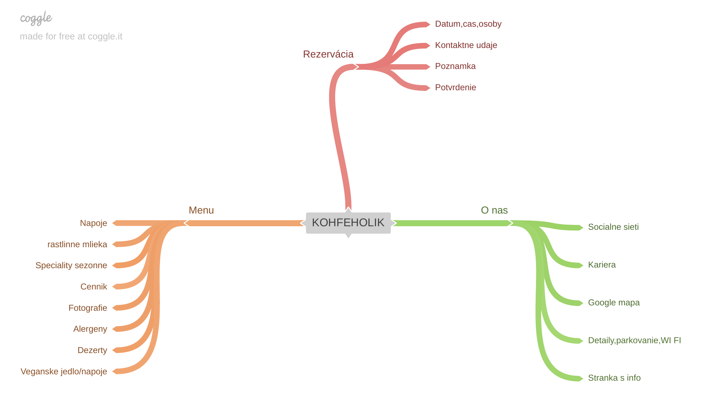
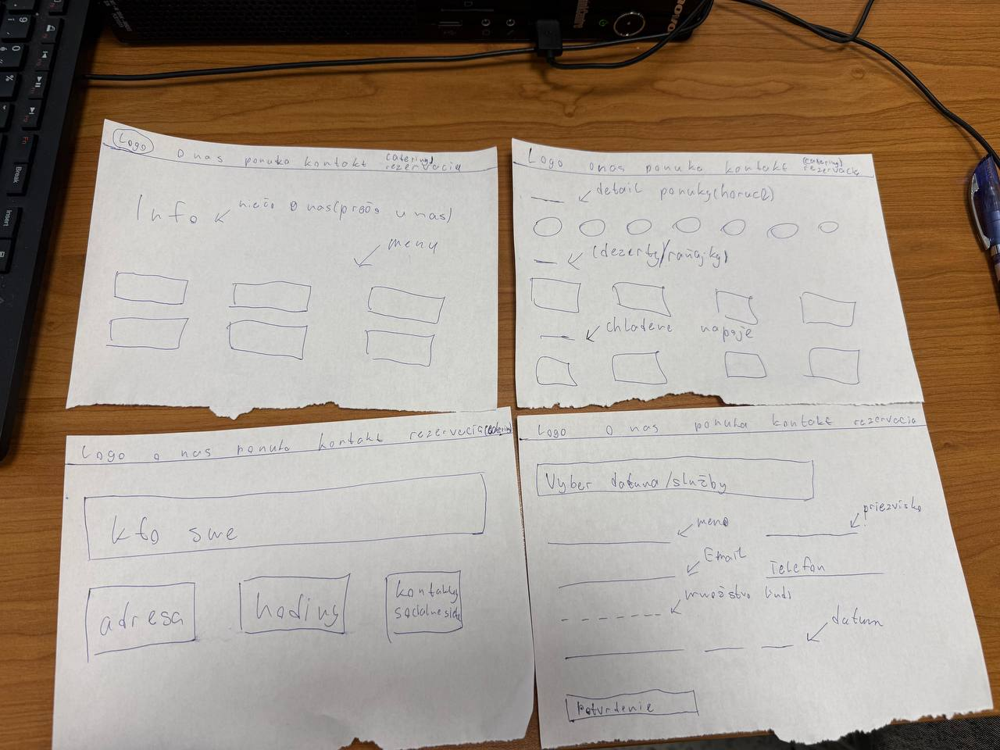
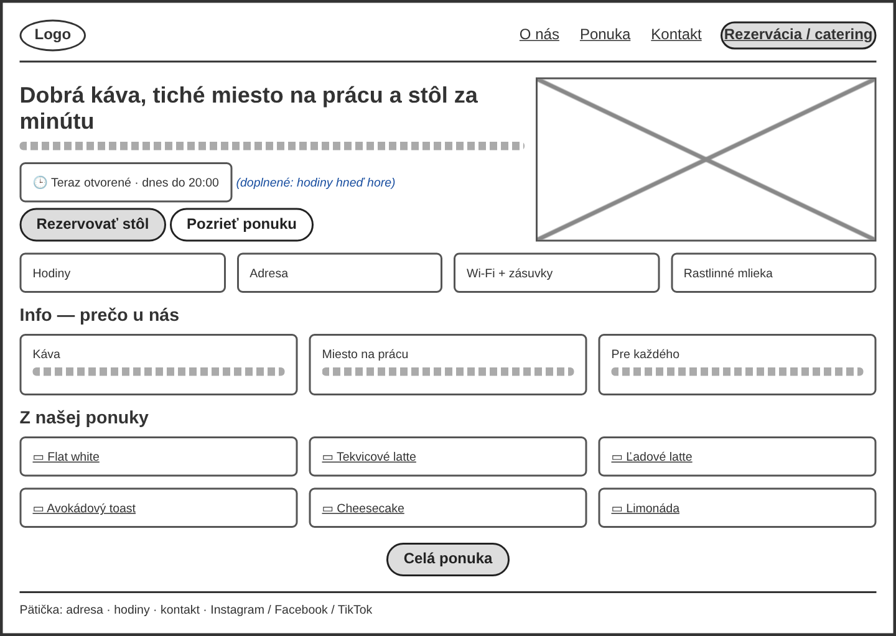
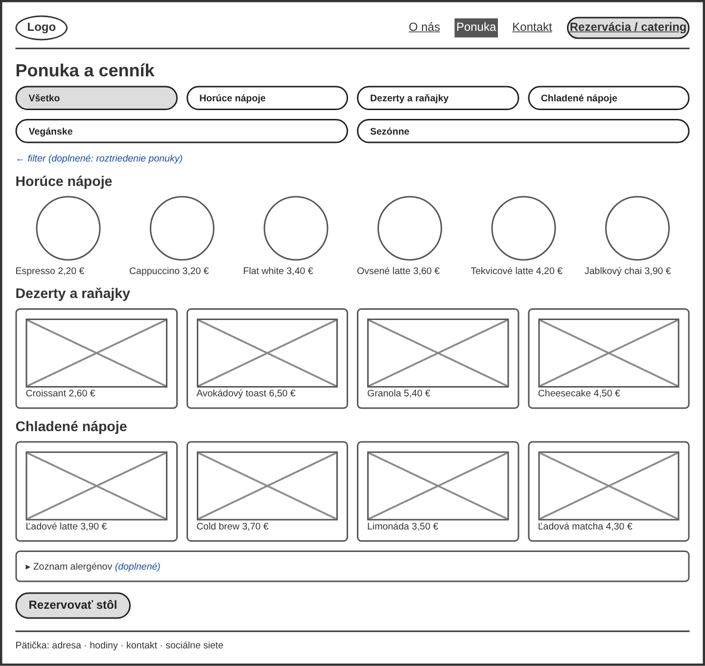
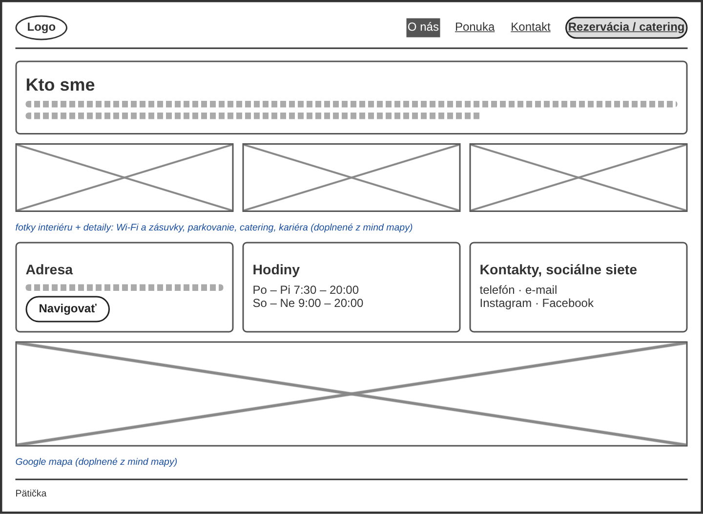
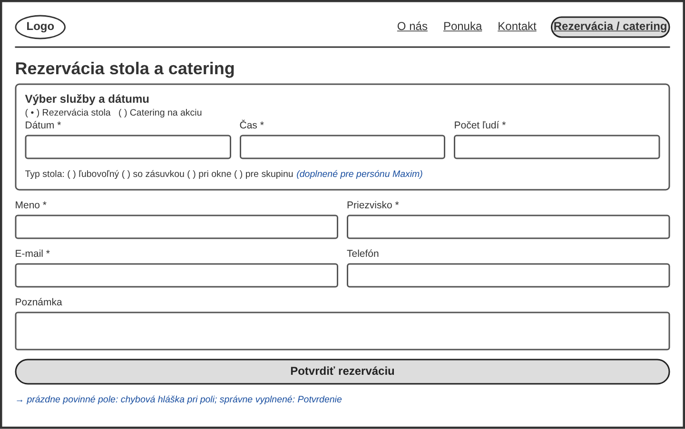
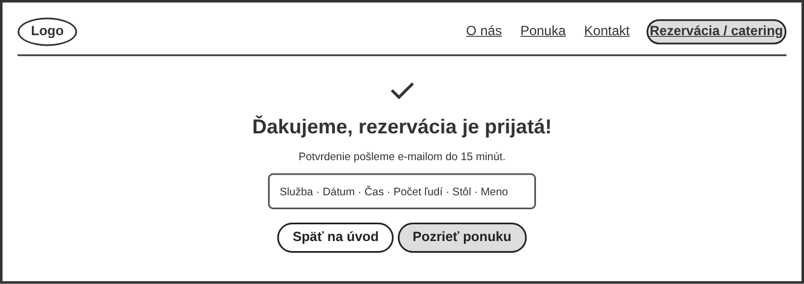

# Zadanie webu: Kaviareň Kohfeholik

Autor: Bohdan Samoilenko, 1ZD531 · Predmet: Návrh a tvorba webových stránok (UNIZA)

## Prompt pre AI

Postav web kaviarne Kohfeholik presne podľa tohto zadania a obrázkov prototypu v `docs/prototyp/`. Stránky: 1) Domov (hero, rýchle info, Prečo u nás, Z našej ponuky, Kto sme, Kontakt a mapa), 2) Ponuka a cenník s filtrom, 3) Rezervácia stola / catering s potvrdením. Drž sa štruktúry, textov a tokov tlačidiel zo zadania, nepridávaj funkcie nad jeho rámec. Kde zadanie mlčí, použi štandardný UX vzor. Čisté HTML, CSS a JavaScript bez frameworkov a knižníc z internetu. Dizajn podľa `docs/style-guide.md`. Všetky texty po slovensky. Web musí fungovať aj na mobile.

## 1. Cieľ

Webová stránka kaviarne Kohfeholik slúži zákazníkom, ktorí hľadajú príjemné miesto na stretnutia, prácu alebo oddych pri kvalitnej káve a občerstvení. Návštevníci na stránke nájdu aktuálnu ponuku, otváracie hodiny, kontaktné informácie a možnosť rezervácie stola. Cieľom webu je uľahčiť zákazníkom získanie potrebných informácií a podporiť návštevnosť kaviarne. Stránka bude jednoduchá, prehľadná a prispôsobená aj pre mobilné zariadenia.

**Kto bude web používať?** Miestni obyvatelia hľadajúci miesto na stretnutie s priateľmi; študenti a pracujúci ľudia, ktorí chcú pracovať alebo študovať pri káve; turisti a návštevníci mesta; potenciálni zákazníci, ktorí si chcú rezervovať stôl alebo zistiť otváracie hodiny.

**Aký problém rieši?** Zákazníci nevedia nájsť aktuálne informácie o ponuke, cenách, otváracích hodinách alebo kontakte. Musia telefonovať alebo hľadať na sociálnych sieťach. Web dá všetky informácie na jedno miesto a umožní jednoduchú rezerváciu stola.

**KPI:**
- zvýšenie počtu online rezervácií o 30 % počas prvých 6 mesiacov,
- aspoň 100 návštev webu týždenne,
- zníženie počtu telefonických otázok o otváracích hodinách a rezerváciách.

**V čom je web lepší ako konkurencia?** Jednoduchá navigácia; rýchla rezervácia stola bez telefonovania; aktuálne menu s fotografiami a cenami; responzívny dizajn pre mobil; prehľadná mapa s navigáciou.

**Prečo web vzniká?** Zvýšiť počet zákazníkov a zlepšiť online prezentáciu kaviarne, budovať značku, propagovať aktuálnu ponuku, znížiť čas personálu strávený odpovedaním na opakujúce sa otázky a podporiť rast tržieb.

## 2. Používatelia

**Maxim (27) — freelancer.** Dobre ovláda techniku, stále má pri sebe notebook a smartfón, hľadá tiché miesto s Wi-Fi a zásuvkami. *„Ťažko sa hľadá kaviareň, kde sú voľné miesta so zásuvkami. Nechcem ísť naslepo."* Potrebuje: informácie o Wi-Fi a miestach na prácu, rýchle menu s cenami, online rezerváciu stola. Firma od neho chce: aby chodil pravidelne v pracovné dni (slabšie hodiny) a rezervoval online namiesto volania. 1. použitie: otvorí web v mobile → fotky interiéru → menu a ceny → prvá rezervácia. 100. použitie: rýchla rezervácia obľúbeného stola, novinky v sezónnom menu.

**Olena (35) — miestna obyvateľka, organizátorka stretnutí.** Žije neďaleko, cení si komfort a kvalitný servis, stretáva sa s priateľmi aj pracovne. *„Nemám čas telefonovať, aby som zistila voľné stoly alebo otváracie hodiny cez víkend."* Potrebuje: kontakt, adresu a mapu, aktuálne otváracie hodiny, rýchlu rezerváciu pre viac ľudí. Firma od nej chce: ukázať úroveň servisu a znížiť počet rutinných telefonátov. 1. použitie: Google Mapy → web → otváracie hodiny → fotky a ponuka → navigácia. 100. použitie: rýchla rezervácia pre partiu, overenie špeciálnych ponúk.

**Tomáš (20) — študent z iného mesta.** Používa smartfón na cestách, slabšie sa orientuje v meste, hľadá príjemné miesto v centre. *„Neznám mesto, je ťažké zistiť, či sa oplatí prísť a kde presne to je."* Potrebuje: mapu s navigáciou, krátky popis konceptu, vizuálne menu s fotkami. Firma od neho chce: zaujať náhodného hosťa a premeniť ho na zákazníka bez klikania navyše. 1. použitie: hľadá kaviareň v okolí → úvodná stránka → mapa a pešia navigácia → ponuka. 100. použitie: nájde web v histórii, skontroluje hodiny a nové menu.

## 3. Štruktúra webu

Informačná architektúra (mind mapa v Coggle) má tri hlavné vetvy:

- **Menu (Ponuka)** — nápoje, rastlinné mlieka, sezónne špeciality, cenník, fotografie, alergény, dezerty, vegánske jedlá a nápoje
- **Rezervácia** — dátum, čas, počet osôb; kontaktné údaje; poznámka; potvrdenie
- **O nás** — sociálne siete, kariéra, Google mapa, detaily (parkovanie, Wi-Fi), stránka s info (otváracie hodiny, kontakt)

Úpravy oproti mind mape (z papierového prototypu): ponuka je rozdelená na **horúce nápoje, dezerty a raňajky, chladené nápoje**; do rezervácie pribudol **catering** (výber služby); kontakt má vlastnú položku v menu.

Hlavná navigácia: **Logo** (vedie na domov) · **O nás** · **Ponuka** · **Kontakt** · tlačidlo **Rezervácia / catering** (vždy viditeľné). Pätička: adresa, otváracie hodiny, kontakt, sociálne siete, rýchle odkazy.

Väzba potreba → funkcia → miesto na webe:

| Persóna potrebuje… | …web musí mať | Kde |
|---|---|---|
| vedieť, či je otvorené (Olena) | otváracie hodiny + stav „teraz otvorené" | hero, rýchle info, kontakt, pätička |
| rezervovať bez telefonovania (všetci) | rezervačný formulár s potvrdením | Rezervácia |
| rezervovať pre partiu / akciu (Olena) | veľký stôl, catering na akciu | Rezervácia |
| miesto so zásuvkou (Maxim) | info o Wi-Fi a zásuvkách, voľba „stôl so zásuvkou" | rýchle info, Prečo u nás, Rezervácia |
| vedieť, čo dostane a za koľko (Maxim, Tomáš) | ponuka s obrázkami, cenami a filtrom | Domov (náhľad), Ponuka |
| nájsť cestu (Tomáš, Olena) | adresa, mapa + tlačidlo „Navigovať" | Kontakt |
| rezervovať znova rýchlo (100. použitie) | „Vyplniť ako minule" | Rezervácia |
| vegánske / bez laktózy | štítky vegánske, rastlinné mlieka, alergény | Ponuka |

## 4. Obrazovky

Obrazovky vychádzajú z papierového prototypu (`docs/prototyp/papierovy-prototyp.png`). Klikateľný wireframe je v `docs/prototyp/index.html`, obrázky obrazoviek sú v `docs/prototyp/`.

**4.1 Domov.** Hlavička (logo vľavo, menu vpravo, tlačidlo Rezervácia / catering). Hero: nadpis „Dobrá káva, tiché miesto na prácu a stôl, ktorý si rezervuješ za minútu.", krátky popis, stav otvorenia (podľa aktuálneho času), tlačidlá **Rezervovať stôl** → Rezervácia a **Pozrieť ponuku** → Ponuka. Pod hero 4 karty rýchleho info (hodiny, adresa, Wi-Fi a zásuvky, rastlinné mlieka). Sekcia **Info — Prečo u nás** (3 karty). Sekcia **Z našej ponuky**: 6 kariet (2 × 3) a tlačidlo **Celá ponuka** → Ponuka. Ďalej sekcie Kto sme a Kontakt (4.3).

**4.2 Ponuka a cenník.** Filtre: Všetko / Horúce nápoje / Dezerty a raňajky / Chladené nápoje / Vegánske / Sezónne. Tri skupiny podľa papierového prototypu: **Horúce nápoje** (okrúhle obrázky), **Dezerty a raňajky**, **Chladené nápoje**. Karta: obrázok, názov, cena, popis, štítky (vegánske, alergény, sezónne). Rozbaľovací zoznam alergénov a výzva **Rezervovať stôl**.

**4.3 Kto sme + Kontakt.** Blok **Kto sme** (text + 3 fotky interiéru), detaily: Wi-Fi a zásuvky, parkovanie, catering, kariéra. Kontakt v troch kartách podľa papiera: **Adresa** (s tlačidlom **Navigovať**), **Otváracie hodiny** (dnešný deň zvýraznený), **Kontakty a sociálne siete**. Pod nimi Google mapa.

**4.4 Rezervácia stola / catering.** 1) **Výber služby a dátumu**: služba (Rezervácia stola / Catering na akciu), dátum, čas (ponuka časov podľa otváracích hodín), počet ľudí (stôl 1–10, catering 10–80), typ stola (ľubovoľný / so zásuvkou / pri okne / pre skupinu — len pri stole); 2) **meno, priezvisko, e-mail, telefón** (pri cateringu povinný); 3) poznámka. Povinné polia: dátum, čas, počet ľudí, meno, priezvisko, e-mail. Tlačidlo **Potvrdiť rezerváciu** (pri cateringu **Odoslať dopyt na catering**): pri chybe sa pri poli zobrazí text chyby, inak Potvrdenie. Pri ďalšej návšteve box „Rýchla rezervácia — Vyplniť ako minule".

**4.5 Potvrdenie.** „Ďakujeme, rezervácia je prijatá!" (catering: „dopyt je odoslaný", ponuka do 24 h), zhrnutie (služba, dátum, čas, počet ľudí, stôl, meno), tlačidlá **Späť na úvod** a **Pozrieť ponuku**.

Interakcie: klik na logo → domov; položky menu → stránky/sekcie; hover na položke menu a tlačidlách zmení farbu; na mobile menu cez hamburger.

## 5. Vizuálny štýl

Teplá, útulná kaviareň — svetlé krémové pozadie, kávovo-hnedé texty, karamelový akcent na hlavné tlačidlá, šalviová zelená pre vegánske a „otvorené". Pätkové písmo na nadpisy, bezpätkové na text. Veľa voľného priestoru, karty so zaoblenými rohmi, fotky jedla a interiéru ako hlavný vizuálny prvok. Detailný popis: `docs/style-guide.md`.
